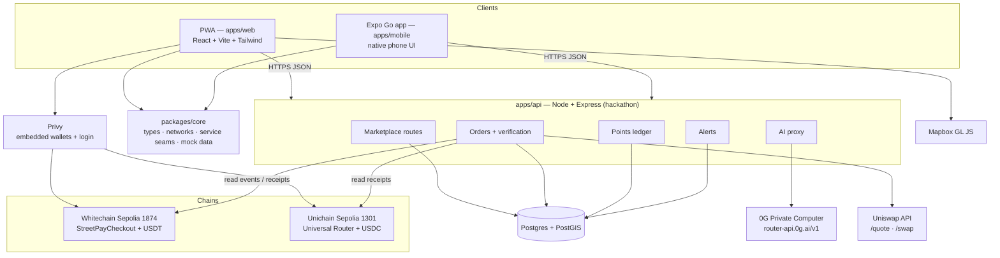
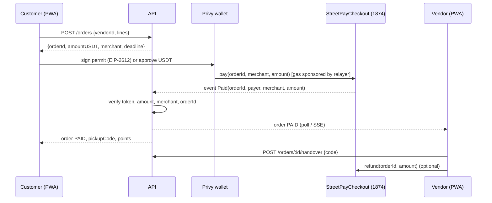
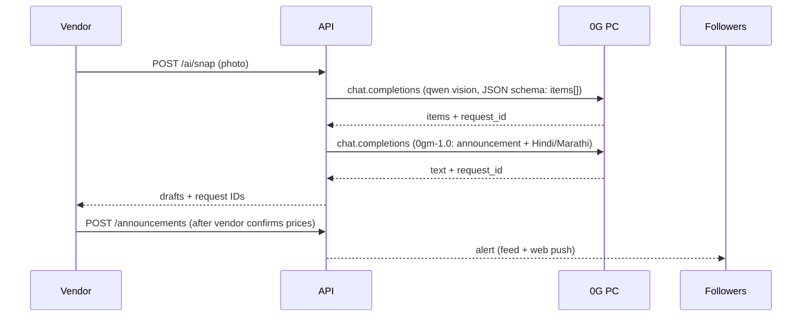

# STREETLAYER — System Architecture

Status (1 Nov 2026): frontend built on mock services. Integrations are written at the hackathon.

## 1. What the system does

| Actor | Can do |
|---|---|
| Customer | Find stalls on a map, follow them, get fresh-stock alerts, order for pickup, pay in crypto (two routes), show a pickup code, earn and redeem points |
| Vendor | Publish stock from a photo or voice note (AI), manage prices/stock, see verified paid orders, hand over with a code, refund (full/partial), export payments CSV |
| STREETLAYER backend | Store marketplace data, verify payments onchain, issue points, call AI, send alerts |

## 2. Component diagram



## 3. Layers

| Layer | Today | Hackathon |
|---|---|---|
| UI | `apps/web` desktop-first site; `apps/mobile` native phone UI (separate designs) | unchanged |
| Domain | `packages/core/src/types.ts` | unchanged — single source of truth |
| Service seams | `packages/core/src/services.ts` interfaces, `mock/services.ts` implementations | `http/*.ts` clients calling `apps/api`; mocks kept for offline demo |
| Map | Web: `MapCanvas.tsx` schematic (no key). Mobile: react-native-maps | Web: `MapboxMap.tsx` with identical `MapViewProps` |
| State | Zustand store (`apps/web/src/store.ts`), persisted locally | store keeps UI state; server data via API |
| Wallet | Simulated sign-in | Privy embedded wallet + external wallets |

Rule: UI components never import a vendor SDK. They call a service. Swapping mock → real is done in one place per integration.

## 4. Key flows

### 4.1 Order + StreetPay (Whitechain USDT)


### 4.2 Pay with ETH (Uniswap → USDC)
```mermaid
sequenceDiagram
  participant C as Customer
  participant API
  participant U as Uniswap API
  participant W as Privy wallet
  participant R as Universal Router (1301)
  C->>API: POST /quotes {orderId}
  API->>U: POST /quote (ETH→USDC, exactOutput = order USDC, recipient = vendor)
  U-->>API: quote + permit data
  API-->>C: quote (amountIn ETH, route, impact, gas)
  C->>API: POST /swap {quoteId}
  API->>U: POST /swap
  U-->>API: tx calldata
  API-->>C: tx
  C->>W: sign + send tx
  W->>R: swap; USDC lands at vendor wallet
  API->>R: read receipt, check Transfer(USDC → vendor, amount)
  API-->>C: PAID
```

### 4.3 Snap & Sell (0G)


## 5. Trust boundaries
- API keys (0G, Uniswap, relayer private key) live only in `apps/api` env. Never in the PWA or Expo bundle.
- Mapbox public token is browser-safe but URL-restricted.
- An order becomes PAID only from an onchain read by the API, never from a client claim.
- AI output is a draft until the vendor taps Publish.
- Relayer: per-wallet rate limit, daily WBT cap, only calls `StreetPayCheckout`.

## 6. Repo layout
```
streetlayer/
├── apps/web          PWA (built)
├── apps/mobile       Expo Go shell (built)
├── apps/api          Express API (hackathon)
├── packages/core     shared types, constants, service seams, mock data (built)
├── contracts/        StreetPayCheckout (hackathon)
└── docs/             this folder
```
