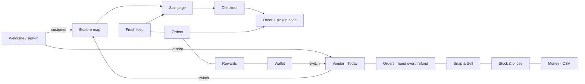

# STREETLAYER — Wireframes & Screen Map

Mobile-first (390 px). Every screen below is built in `apps/web/src/screens/`. Hi-fi screenshots: run the app.

## Screen map



Customer tabs: Explore · Fresh · Orders · Rewards · Wallet
Vendor tabs: Today · Orders · Snap & Sell · Stock · Money

## Customer

```
EXPLORE                         STALL PAGE                      CHECKOUT
┌───────────────────────────┐   ┌───────────────────────────┐   ┌───────────────────────────┐
│ KALBADEVI · MUMBAI  [Vendor]│ │ ‹ Ravi's Fresh Sabzi      │   │ ‹ Your order              │
│ 12 stalls near you        │   │ 🥬 Ravi's Fresh Sabzi ✓   │   │ 🍅 Tomatoes  [-1+]  ₹30   │
│ [🔍 Search…        ] [≡]  │   │ Vegetables · 259 m · ★4.7 │   │ 🥬 Spinach   [-1+]  ₹20   │
│ (All)(Fresh)(Offers)(…)   │   │ [🔔 Follow for alerts   ] │   │ PAY WITH                  │
│ ┌───────── map ─────────┐ │   │ USDT·Whitechain ETH→USDC  │   │ ( ) Pay with ETH  · 1301  │
│ │   📍  📍     [+]       │ │   │ 🏷 5% off on 3 kg+        │   │ (•) StreetPay USDT · 1874 │
│ │ 📍  ◉you   📍 [−]      │ │   │ ┌ Latest from Ravi ─────┐ │   │ ┌ Uniswap quote ────────┐ │
│ │      📍 🟢fresh [⌖]    │ │   │ │ Fresh stock from Nashik│ │   │ │ You pay 0.0002 ETH     │ │
│ └───────────────────────┘ │   │ └───────────────────────┘ │   │ │ Vendor gets 0.60 USDC  │ │
│ ┌ peek card ────────────┐ │   │ FRESH TODAY               │   │ └───────────────────────┘ │
│ │🥬 Ravi's… [Following] │ │   │ 🍅 Tomatoes ₹30/kg [Add] │   │ 🛡 Verified onchain note  │
│ │🍅₹30 🥬₹20 🥕₹50 🧅₹40│ │   │ 🥬 Spinach ₹20    [Add]  │   ├───────────────────────────┤
│ │ badges     [Open stall]│ │  ├───────────────────────────┤   │ ₹50 ≈0.60 USDT [Pay 0.60] │
│ └───────────────────────┘ │   │ 2 items ₹50 [Review order]│   └───────────────────────────┘
│ Explore Fresh Orders …    │   └───────────────────────────┘
└───────────────────────────┘

PAYING → ORDER                  FRESH FEED                      REWARDS
┌───────────────────────────┐   ┌───────────────────────────┐   ┌───────────────────────────┐
│ ✓ Order created           │   │ Fresh stock · 3 stalls    │   │ ███ STREET points  412 ███│
│ ✓ Approve USDT            │   │ 🥬 Ravi's  2h ago  [NEW]  │   │ REDEEM                    │
│ ◌ StreetPay checkout      │   │ 🌱 Fresh stock from Nashik│   │ ☕ Free cutting chai [30] │
│ ◌ Verified onchain        │   │ (English)(Marathi)(Hindi) │   │ BADGES  🪙 🏪 🔥 ⭐ ▓▓░░  │
├───────────────────────────┤   │ 🍅₹30 🥬₹20 🥕₹50         │   │ HISTORY +11 +5 +25 −30    │
│ SHOW THIS AT THE STALL    │   │ 0G · req_…   [Reserve now]│   └───────────────────────────┘
│        [ QR ]   CV-420    │   │ Fresh at stalls you don't │
│ ✓ Paid ◌ Packed ◌ Picked  │   │ follow …          [Follow]│   WALLET: address, Receive QR,
│ Items · Onchain receipt   │   └───────────────────────────┘   balances per network, faucet,
│ +5 STREET points          │                                   demo controls (switch / reset)
└───────────────────────────┘
```

## Vendor

```
TODAY                           ORDERS                          SNAP & SELL
┌───────────────────────────┐   ┌───────────────────────────┐   ┌───────────────────────────┐
│ Ravi's Fresh Sabzi [QR][👤]│  │ [To hand over (2)][Done]  │   │ [Photo][Voice][Announce]  │
│ ┌Sales ₹314┐┌Pickups 2┐   │   │ AS-731      Paid·verified │   │ ┌ - - - - - - - - - - ┐  │
│ └Customers┘└Followers 128┘│   │ Arjun · 18 min            │   │   📷 Take a photo of     │
│ TELL YOUR CUSTOMERS       │   │ 2×Tomatoes ₹60 …          │   │   today's stock          │
│ [📷Snap][🎙Speak][📣Ann.] │   │ ┌ 0.95 USDT received ───┐ │   │ └ - - - - - - - - - - ┘  │
│ PICKUP QUEUE              │   │ │✓wallet ✓token ✓amount │ │   │ [✨ Make my listing]      │
│ AS-731 Arjun … Paid       │   │ └───────────────────────┘ │   │ 0G · model · request id   │
│ THIS WEEK  ▁▃▂▅▄▇▃        │   │ [Mark packed][Hand over]  │   │ 🥭 Alphonso  ₹[480] [6]   │
│ RUNNING LOW 🥕 8 left     │   │ [Refund]                  │   │ Alert preview (EN/HI/MR)  │
└───────────────────────────┘   │ Hand over: enter code →✓  │   │ [✓ Publish listing+alert] │
                                │ Refund: tick items, reason│   └───────────────────────────┘
STOCK: list, inline price,      └───────────────────────────┘   MONEY: USDT + USDC totals,
on/off toggle, AI ✨ / fresh 🌱                                  tx list with explorer links,
                                                                Export CSV for accountant
```

## Design notes
- Palette: board-green ink + marigold accent (garland colour of every Mumbai stall); light and dark themes via CSS variable tokens.
- Type: Bricolage Grotesque (display), IBM Plex Sans (body), IBM Plex Mono (codes, hashes, chain IDs).
- Every mocked value carries a "Simulated" / "Testnet" badge so the demo is honest.
- Pickup codes are mono, large and spaced so vendors can read them at arm's length.
